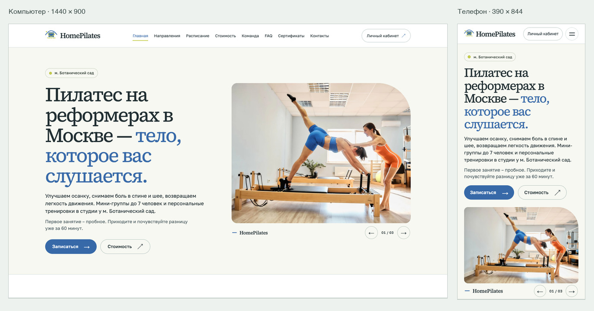
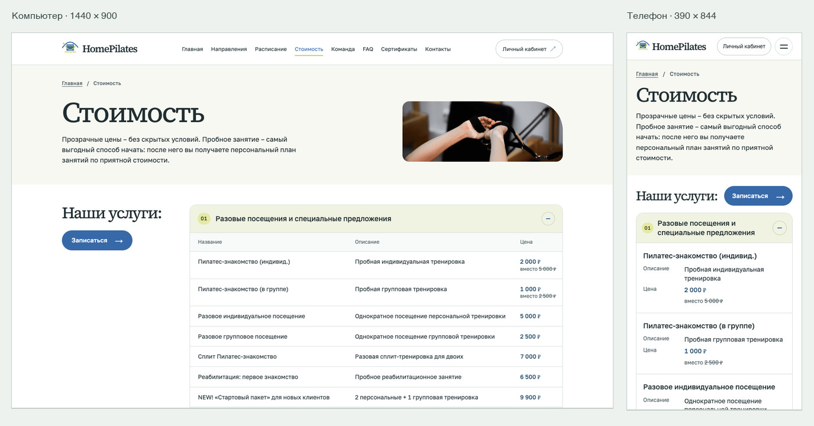

# HomePilates · восемь прототипов для согласования

[Скачать комплект для просмотра](https://github.com/elenaisanewleet/homepilates-tz-3/raw/refs/heads/main/HomePilates-review.zip). Распакуйте ZIP и откройте **Открыть.html**. В галерее есть восемь интерактивных страниц, снимки главной и стоимости на компьютере и телефоне, а также примеры раскрытых абонементов.

| Главная | Стоимость |
|---|---|
|  |  |

[Карта сборки в Tilda](review/tilda-map.md) · [Проверки в браузере](review/verification/report.md) · [План приёмки на стенде](review/acceptance.md) · [Лист согласования](review/decisions.md).

Для просмотра из клона откройте `review/index.html` в браузере. Чтобы пройти страницы по локальным HTTP-адресам, запустите `python3 -m http.server 8247 --bind 127.0.0.1 --directory review/site` и откройте [главную](http://127.0.0.1:8247/).

Для пересборки нужны Python 3 и утилита `cwebp`. Из корня репозитория выполните `python3 design/build.py`. Скрипт берёт исходные тексты и изображения студии из `homepilates-sources/`, структурированные данные — из `design/shared/content.json` и записывает восемь страниц в `review/site/`.
